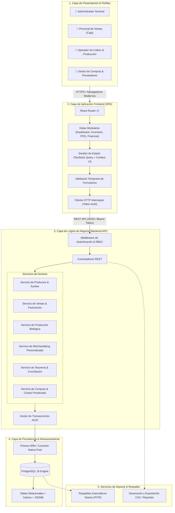
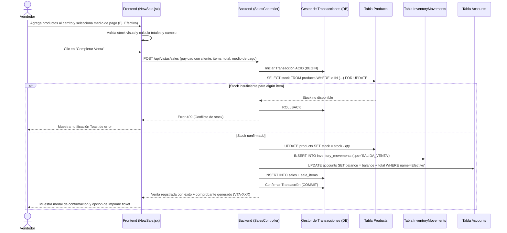
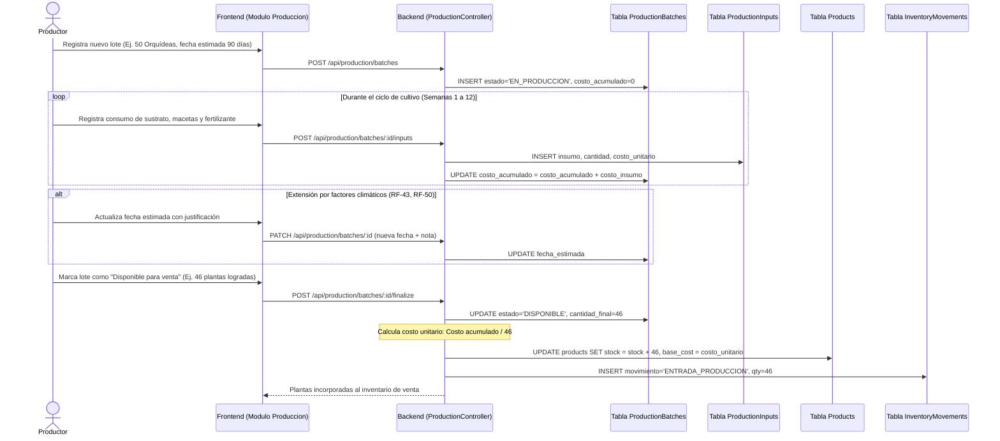
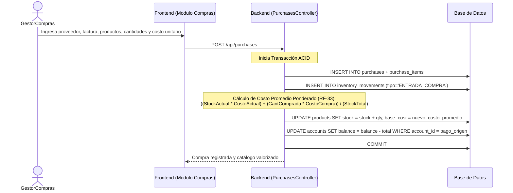
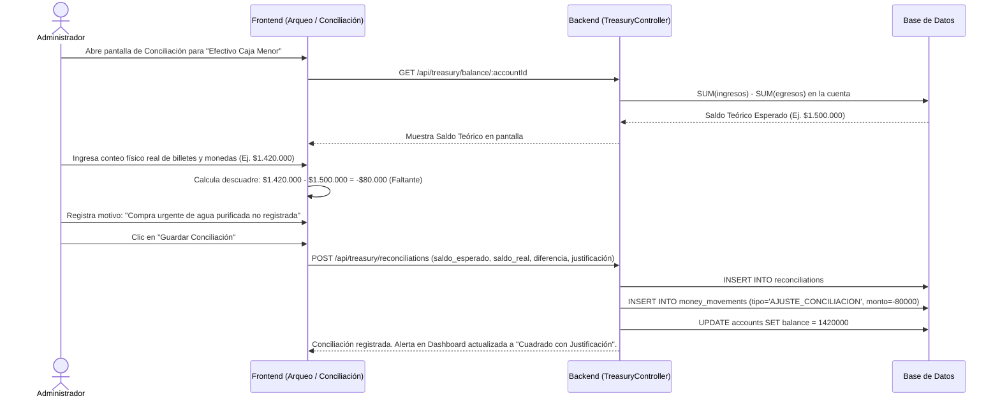
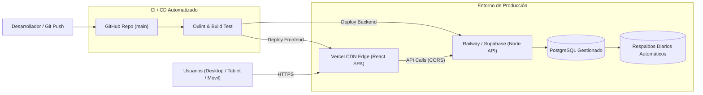

# 📐 Arquitectura del Sistema — Vivero Colibrí

Este documento profundiza en la estructura técnica, distribución por capas y flujos de información del sistema **Vivero Colibrí**, complementando la especificación inicial descrita en [`docs/disenio_tecnico_inicial.docx`](docs/disenio_tecnico_inicial.docx).

---

## 🏛️ 1. Visión Arquitectónica General

El sistema se fundamenta en una **arquitectura por capas desacopladas** (Clean Architecture / N-Tier Architecture) para garantizar mantenibilidad, trazabilidad contable y evolución modular conforme a los requisitos no funcionales RNF-30 a RNF-33:

---

## 👥 2. Perfiles de Usuario y Matriz de Control de Acceso (RBAC)

El acceso a las funcionalidades y rutas se controla mediante roles (RNF-22 y RNF-23):

| Módulo / Función | Administrador | Vendedor / Caja | Operador de Producción |
| :--- | :---: | :---: | :---: |
| **Panel de Inicio (Dashboard General)** | Total | Limitado (solo KPIs de turno) | Limitado (solo alertas de cultivo) |
| **Punto de Venta (Nueva Venta, Carrito, Cobro)** | Total | Total | Sin acceso |
| **Historial de Ventas & Reimpresión de Tickets** | Total | Total | Sin acceso |
| **Gestión de Inventario (Edición de Precios/Costos)** | Total | Solo lectura | Solo lectura |
| **Ajustes de Inventario (Entradas/Salidas manuales)** | Total | Sin acceso | Con aprobación |
| **Compras & Gestión de Proveedores** | Total | Sin acceso | Sin acceso |
| **Producción Propia (Cultivo, Insumos, Cosecha)** | Total | Sin acceso | Total |
| **Merchandising Personalizado (Cotización)** | Total | Total | Sin acceso |
| **Tesorería, Arqueo de Caja y Conciliación Bancaria** | Total | Solo arqueo de caja turno | Sin acceso |
| **Métricas Financieras, Balance y Reportes** | Total | Sin acceso | Sin acceso |

---

## 🔄 3. Flujos de Información y Diagramas de Secuencia Transaccionales

Conforme a la sección 2.10 de [`docs/disenio_tecnico_inicial.docx`](docs/disenio_tecnico_inicial.docx), los siguientes diagramas de secuencia especifican la interacción exacta entre capas para los procesos neurálgicos del negocio:

### 3.1. Flujo 1: Registro de una Venta en Punto de Venta (POS)
Garantiza que la venta, el descuento de stock, el movimiento en el kardex y la entrada de dinero en la cuenta de pago ocurran de forma atómica:

---

### 3.2. Flujo 2: Ciclo de Vida de Producción Propia de Plantas
Controla los tiempos biológicos no uniformes y la acumulación de costos hasta la incorporación al inventario comercial:

---

### 3.3. Flujo 3: Registro de Compra a Proveedor y Costeo Ponderado
Maneja el abastecimiento y la actualización automática del costo promedio:

---

### 3.4. Flujo 4: Arqueo y Conciliación de Fondos (Efectivo vs. Cuentas)
Responde a la pregunta clave del cliente: *¿Por qué el sistema dice que debería haber $X, pero en la realidad hay $Y?*:

---

## 🔒 4. Integridad de la Información y Reglas Anti-Fraude

Para cumplir estrictamente con los RNF-16 a RNF-24:

1. **Inmutabilidad de Transacciones Cerradas:** Una venta o compra confirmada **nunca se elimina físicamente** de la base de datos (`NO HARD DELETE`). Si se requiere una anulación, se genera un registro de anulación que revierte el inventario y genera un movimiento compensatorio en tesorería.
2. **Restricción de Integridad Referencial:** Ningún producto o proveedor con transacciones históricas puede ser eliminado (`ON DELETE RESTRICT`). Solo se permite marcarlo como `active = false` para ocultarlo en nuevos formularios.
3. **Bloqueo Pesimista en Checkout:** Para evitar que dos clientes compren simultáneamente la última unidad de una orquídea en stock, la transacción bloquea la fila del producto (`SELECT ... FOR UPDATE`) hasta confirmar el decremento.
4. **Idempotencia en APIs de Cobro:** Cada petición de venta enviada desde el frontend lleva un identificador único idempotente para evitar duplicar cargos si el usuario presiona dos veces el botón de pago bajo mala conectividad.

---

## 🌐 5. Estrategia de Despliegue e Infraestructura

Esta arquitectura garantiza el cumplimiento de los 38 requisitos no funcionales, permitiendo a la iniciativa social contar con una plataforma robusta, segura y auditable.
