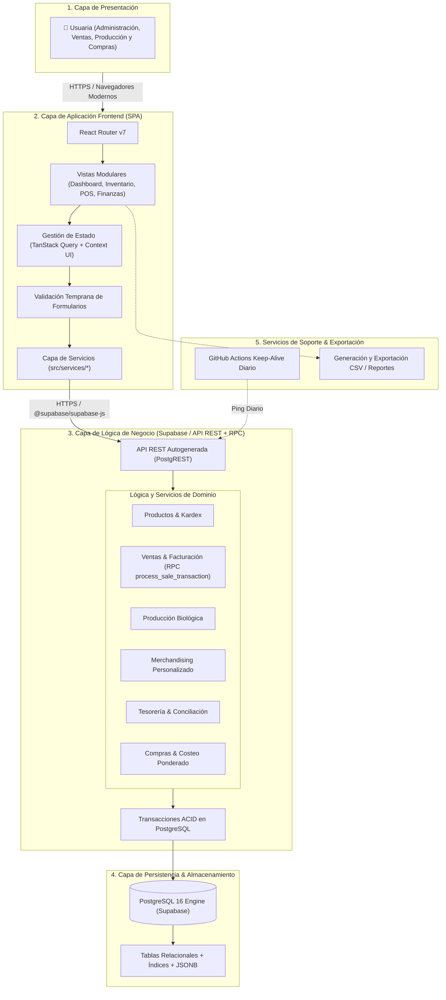
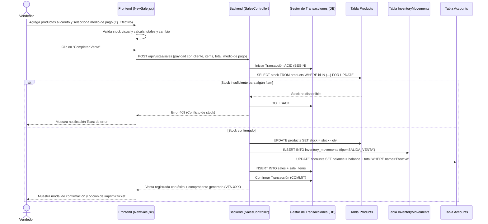
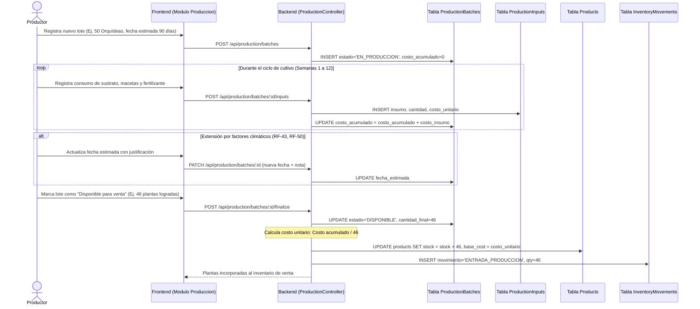
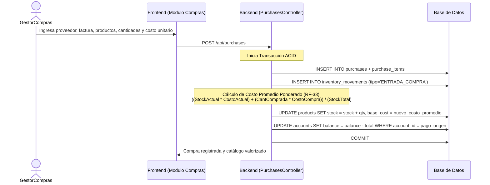
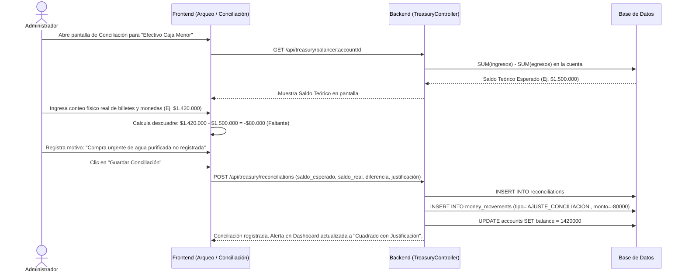
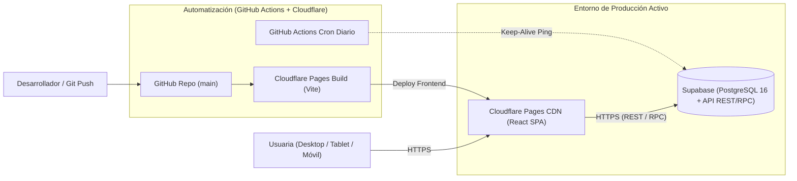

# 📐 Arquitectura del Sistema — Vivero Colibrí

Este documento profundiza en la estructura técnica, distribución por capas y flujos de información del sistema **Vivero Colibrí**, complementando la especificación inicial descrita en [`docs/disenio_tecnico_inicial.docx`](docs/disenio_tecnico_inicial.docx).

---

## 🏛️ 1. Visión Arquitectónica General

El sistema se fundamenta en una **arquitectura por capas desacopladas** para garantizar mantenibilidad, trazabilidad contable y evolución modular conforme a los requisitos no funcionales RNF-30 a RNF-33. Dado que la aplicación será operada directamente por la clienta, se prescinde de módulos de autenticación y control de roles:

---

## 🔄 2. Flujos de Información y Diagramas de Secuencia Transaccionales

Conforme a la sección 2.10 de [`docs/disenio_tecnico_inicial.docx`](docs/disenio_tecnico_inicial.docx), los siguientes diagramas de secuencia especifican la interacción exacta entre capas para los procesos neurálgicos del negocio:

### 2.1. Flujo 1: Registro de una Venta en Punto de Venta (POS)
Garantiza que la venta, el descuento de stock, el movimiento en el kardex y la entrada de dinero en la cuenta de pago ocurran de forma atómica:

---

### 2.2. Flujo 2: Ciclo de Vida de Producción Propia de Plantas
Controla los tiempos biológicos no uniformes y la acumulación de costos hasta la incorporación al inventario comercial:

---

### 2.3. Flujo 3: Registro de Compra a Proveedor y Costeo Ponderado
Maneja el abastecimiento y la actualización automática del costo promedio:

---

### 2.4. Flujo 4: Arqueo y Conciliación de Fondos (Efectivo vs. Cuentas)
Responde a la pregunta clave del cliente: *¿Por qué el sistema dice que debería haber $X, pero en la realidad hay $Y?*:

---

## 🔒 3. Integridad de la Información y Reglas Operativas

Para cumplir estrictamente con los RNF-16 a RNF-21:

1. **Inmutabilidad de Transacciones Cerradas:** Una venta o compra confirmada **nunca se elimina físicamente** de la base de datos (`NO HARD DELETE`). Si se requiere una anulación, se genera un registro de anulación que revierte el inventario y genera un movimiento compensatorio en tesorería.
2. **Restricción de Integridad Referencial:** Ningún producto o proveedor con transacciones históricas puede ser eliminado (`ON DELETE RESTRICT`). Solo se permite marcarlo como `active = false` para ocultarlo en nuevos formularios.
3. **Bloqueo Pesimista en Checkout:** Para evitar condiciones de carrera en el inventario, la transacción bloquea la fila del producto (`SELECT ... FOR UPDATE`) hasta confirmar el decremento.
4. **Control de Duplicados en Cobro:** El botón de confirmación se bloquea durante el envío y la base de datos asigna el consecutivo único (`VTA-XXXX`) mediante secuencia transaccional.

---

## 🌐 4. Estrategia de Despliegue e Infraestructura (En Producción)

Esta arquitectura garantiza el cumplimiento de los 35 requisitos no funcionales, permitiendo a la iniciativa social contar con una plataforma robusta y auditable a costo $0.00.
