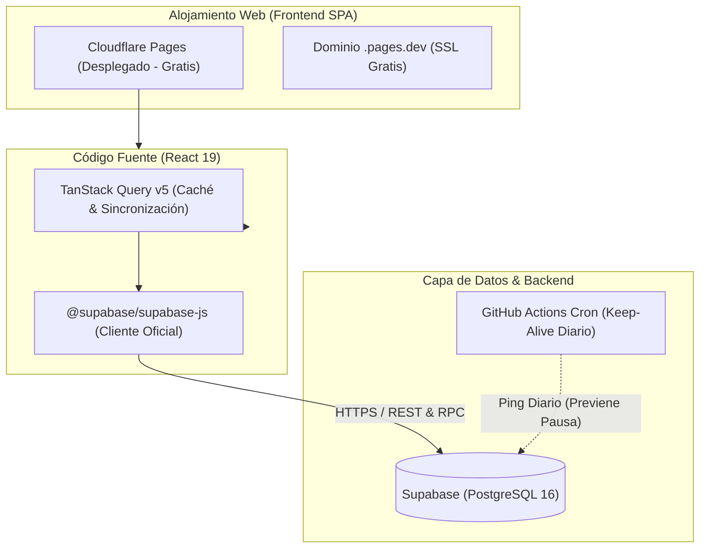

# 🚀 Guía Integral de Despliegue, Servicios y Soluciones Gratuitas (Cero Costo) — Vivero Colibrí

> **Enfoque de Labor Social:** Esta guía prioriza herramientas de alta calidad técnica con **costo $0.00 permanente**, eliminando el riesgo de cobros imprevistos o interrupciones operativas para el cliente del vivero.

---

## 📋 Índice

1. [Arquitectura de Servicios Propuesta](#1-arquitectura-de-servicios-propuesta)
2. [Alojamiento Frontend: Vercel vs. Alternativas 100% Gratuitas](#2-alojamiento-frontend-vercel-vs-alternativas-100-gratuitas)
   - [Opción A: Vercel (Rápido, pero con límites)](#opción-a-vercel-despliegue-en-1-clic)
   - [Opción B: Cloudflare Pages (Recomendada: Ancho de Banda Ilimitado y Cero Costo)](#opción-b-cloudflare-pages-solución-definitiva-cero-costo)
3. [Base de Datos & Backend: Supabase vs. Alternativas Sin Pausa](#3-base-de-datos--backend-supabase-vs-alternativas-sin-pausa)
   - [Guía de Implementación con Supabase](#guía-de-implementación-con-supabase)
   - [⚠️ El Problema de Inactividad de Supabase (Pausa a los 7 días)](#️-el-problema-de-inactividad-de-supabase-pausa-a-los-7-días)
   - [Solución: Automatización Keep-Alive Gratuita con GitHub Actions](#solución-automatización-keep-alive-gratuita-con-github-actions)
   - [Alternativa 100% Gratuita & Offline-Friendly: PocketBase](#alternativa-100-gratuita--offline-friendly-pocketbase)
4. [Integración de TanStack Query (React Query v5)](#4-integración-de-tanstack-query-react-query-v5)
   - [Instalación y Configuración del Cliente](#41-instalación-y-configuración-del-cliente)
   - [Conexión con Supabase y Reemplazo de LocalStorage](#42-conexión-con-supabase-y-reemplazo-de-localstorage)
   - [Manejo de Mutaciones y Mutaciones Optimistas](#43-manejo-de-mutaciones-y-mutaciones-optimistas)
5. [Variables de Entorno y Configuración Paso a Paso](#5-variables-de-entorno-y-configuración-paso-a-paso)

---

## 1. Arquitectura de Servicios Propuesta



---

## 2. Alojamiento Frontend: Vercel vs. Alternativas 100% Gratuitas

### Comparativa de Planes Gratuitos

| Proveedor | Ancho de Banda Mensual | Límite de Peticiones | Certificado SSL | Riesgo de Cobro Imprevisto | Veredicto para Labor Social |
| :--- | :---: | :---: | :---: | :---: | :---: |
| **Vercel (Hobby)** | 100 GB | 1,000,000 ejecuciones | Gratis (Automático) | Medio (Términos comerciales estrictos) | Bueno para prototipos |
| **Cloudflare Pages** | **ILIMITADO** | **ILIMITADO** | Gratis (Automático) | **CERO (0% riesgo)** | ✅ **En uso (Desplegado)** |
| **GitHub Pages** | 100 GB | Ilimitado | Gratis | **CERO** | Excelente alternativa |

---

### Opción A: Vercel (Despliegue en 1 Clic)

1. Ingresa a [vercel.com](https://vercel.com/) e inicia sesión con la cuenta de GitHub de la organización o proyecto.
2. Haz clic en **"Add New..."** → **"Project"**.
3. Selecciona el repositorio `Vivero`.
4. Vercel detectará automáticamente Vite:
   - **Framework Preset:** `Vite`
   - **Root Directory:** `./`
   - **Build Command:** `npm run build`
   - **Output Directory:** `dist`
5. En la sección **Environment Variables**, añade:
   - `VITE_SUPABASE_URL` = `https://tu-proyecto.supabase.co`
   - `VITE_SUPABASE_ANON_KEY` = `tu-clave-anon`
6. Haz clic en **Deploy**. Cada `git push` a la rama `main` generará un despliegue automático en segundos.

> [!WARNING]
> En Vercel, para evitar errores `404 Not Found` al recargar rutas directas (como `/ventas` o `/inventario`), debes incluir un archivo `vercel.json` en la raíz con la regla de reescritura SPA:
> ```json
> {
>   "rewrites": [{ "source": "/(.*)", "destination": "/index.html" }]
> }
> ```

---

### Opción B: Cloudflare Pages (Solución Definitiva Cero Costo — ✅ Desplegado)

**¿Por qué es superior para este proyecto?** Cloudflare Pages ofrece **ancho de banda ilimitado y peticiones ilimitadas** en su capa gratuita sin requerir tarjeta de crédito.

#### Pasos para Desplegar en Cloudflare Pages:
1. Crea una cuenta gratuita en [dash.cloudflare.com](https://dash.cloudflare.com/).
2. En el menú lateral, dirígete a **Workers & Pages** → **Create application** → pestaña **Pages**.
3. Selecciona **Connect to Git** y autoriza tu repositorio de GitHub `Vivero`.
4. Configura los parámetros de compilación:
   - **Framework preset:** `Vite`
   - **Build command:** `npm run build`
   - **Build output directory:** `dist`
5. En **Environment variables**, añade las claves `VITE_SUPABASE_URL` y `VITE_SUPABASE_ANON_KEY`.
6. Haz clic en **Save and Deploy**.
7. **Soporte SPA:** En Cloudflare Pages, crea un archivo `public/_redirects` con el siguiente contenido para soportar React Router:
   ```text
   /*    /index.html   200
   ```

---

## 3. Base de Datos & Backend: Supabase vs. Alternativas Sin Pausa

### Guía de Implementación con Supabase

Supabase provee una base de datos relacional PostgreSQL completa con API REST automática y funciones transaccionales.

#### Paso 1: Crear el Proyecto
1. Ingresa a [supabase.com](https://supabase.com/) y crea una cuenta gratuita.
2. Haz clic en **"New Project"**.
3. Asigna un nombre: `vivero-colibri-db`.
4. Define una contraseña segura para la base de datos (guárdala en un gestor seguro).
5. Selecciona la región más cercana al cliente (por ejemplo, `South America (São Paulo)` o `East US`).
6. Espera aproximadamente 1-2 minutos a que el clúster PostgreSQL se aprovisione.

#### Paso 2: Ejecutar el Esquema Relacional (DDL) y Datos Semilla
1. En el panel izquierdo de Supabase, entra a **SQL Editor**.
2. Haz clic en **New query**.
3. Abre el archivo [`supabase/schema.sql`](supabase/schema.sql) del repositorio, copia todo su contenido y pégalo en el editor SQL de Supabase. Haz clic en **Run**.
   - Esto creará automáticamente las 14 tablas relacionales, secuencias, llaves foráneas, índices, la función transaccional ACID `process_sale_transaction` y las políticas de seguridad Row-Level Security (RLS).
4. Haz clic en **New query** nuevamente, abre el archivo [`supabase/seed.sql`](supabase/seed.sql), copia su contenido y haz clic en **Run**.
   - Esto cargará los datos iniciales de categorías, proveedores, cuentas de dinero, productos, inventario inicial y ventas de prueba.
5. Haz clic en **New query** otra vez, abre [`supabase/migration_01_conexion_frontend.sql`](supabase/migration_01_conexion_frontend.sql), copia su contenido y haz clic en **Run**.
   - Esto ajusta la función de ventas para que la base de datos genere el número `VTA-XXXX`, recalcule los totales, guarde el costo unitario y use la hora de Colombia, y registra en el Kardex el stock inicial de cada producto nuevo. Ver [`docs/conexion_base_datos.md`](docs/conexion_base_datos.md).
6. Verifica en el menú **Table Editor** que las tablas aparezcan creadas y pobladas con sus respectivos registros.

#### Paso 3: Obtener Credenciales de Conexión
1. Dirígete a **Project Settings** (icono de engranaje) → **API**.
2. Copia los siguientes valores:
   - **Project URL:** `https://xxxxxxxxxxxx.supabase.co`
   - **Project API Keys:** La clave `anon` / `public` (segura para usar en el frontend mediante Row-Level Security).

---

### ⚠️ El Problema de Inactividad de Supabase (Pausa a los 7 días)

En el plan gratuito de Supabase, **si un proyecto no recibe solicitudes a la base de datos durante 7 días continuos, se pausa automáticamente**. Cuando esto ocurre:
- Los clientes ven un error de conexión en la aplicación web.
- El administrador debe entrar manualmente a la consola de Supabase y presionar el botón "Restore project", lo que tarda unos minutos.

En un vivero comunitario, durante vacaciones, cierres por lluvia o temporadas bajas, es muy probable que pasen 7 días sin registrar transacciones.

---

### Solución: Automatización Keep-Alive Gratuita con GitHub Actions

Para mantener Supabase **siempre activo de forma 100% gratuita y desatendida**, configuramos un flujo de trabajo de GitHub Actions que realiza una consulta ligera a la base de datos cada 24 horas.

Crea el archivo `.github/workflows/supabase-keepalive.yml`:

```yaml
name: Supabase Keep-Alive

on:
  schedule:
    # Se ejecuta todos los días a las 12:00 UTC (7:00 AM hora Colombia)
    - cron: '0 12 * * *'
  workflow_dispatch: # Permite ejecutarlo manualmente desde GitHub

jobs:
  ping-supabase:
    runs-on: ubuntu-latest
    env:
      SUPABASE_URL: ${{ secrets.SUPABASE_URL || secrets.VITE_SUPABASE_URL || vars.SUPABASE_URL || vars.VITE_SUPABASE_URL }}
      SUPABASE_ANON_KEY: ${{ secrets.SUPABASE_ANON_KEY || secrets.VITE_SUPABASE_ANON_KEY || vars.SUPABASE_ANON_KEY || vars.VITE_SUPABASE_ANON_KEY }}
    steps:
      - name: Ping Supabase REST API
        run: |
          URL=$(printf '%s' "$SUPABASE_URL" | tr -d '[:space:]' | sed 's:/*$::')
          KEY=$(printf '%s' "$SUPABASE_ANON_KEY" | tr -d '[:space:]')
          RESPONSE_FILE=$(mktemp)
          HTTP_CODE=$(curl -sS -o "$RESPONSE_FILE" -w "%{http_code}" -X GET "$URL/rest/v1/categories?select=id&limit=1" \
            -H "apikey: $KEY" \
            -H "Authorization: Bearer $KEY")
          echo "HTTP status: $HTTP_CODE"
          cat "$RESPONSE_FILE"
          [ "$HTTP_CODE" -ge 200 ] && [ "$HTTP_CODE" -lt 300 ]
```

**Configuración en GitHub:**
1. Asegúrate de haber ejecutado [`supabase/migration_01_conexion_frontend.sql`](supabase/migration_01_conexion_frontend.sql) (o la versión actualizada de [`supabase/schema.sql`](supabase/schema.sql)) en el SQL Editor de Supabase: sin los `GRANT USAGE/SELECT ... TO anon`, PostgREST rechaza la consulta a `categories` con HTTP 401 (`permission denied for table categories`, `curl` exit code 22) aunque las políticas RLS estén abiertas.
2. Ve a tu repositorio en GitHub → **Settings** → **Secrets and variables** → **Actions**.
3. Añade `SUPABASE_URL` y `SUPABASE_ANON_KEY` (también se aceptan `VITE_SUPABASE_URL` / `VITE_SUPABASE_ANON_KEY`).
4. ¡Listo! La base de datos permanecerá activa indefinidamente a costo $0.

---

### Alternativa 100% Gratuita & Offline-Friendly: PocketBase

Si la conectividad a Internet en el vivero físico es inestable o el equipo no desea depender de servicios en la nube:

- **¿Qué es PocketBase?** Un backend completo de código abierto en **un solo archivo ejecutable** (`pocketbase.exe` de ~15 MB).
- **Ventajas:**
  - Incluye base de datos SQLite embebida con transacciones ACID, sistema de usuarios y autenticación, panel administrativo web visual y API REST en tiempo real.
  - **Cero costo de alojamiento:** Se puede ejecutar localmente en la computadora del vivero, funcionando **100% sin conexión a Internet**.
  - Opcionalmente, se puede desplegar gratis en [Fly.io](https://fly.io/) (capa gratuita de 3 VMs pequeñas) o en un VPS gratuito de Oracle Cloud (Always Free).

---

## 4. Integración de TanStack Query (React Query v5)

TanStack Query sustituye la manipulación manual de `localStorage` y de variables de estado globales, proveyendo:
- Caché en memoria para evitar consultas repetitivas al servidor.
- Estados automáticos de carga (`isLoading`), éxito (`isSuccess`) y error (`isError`).
- Revalidación en segundo plano y actualización optimista de inventario.

### 4.1. Instalación y Configuración del Cliente

Instala el paquete en el proyecto:

```bash
npm install @tanstack/react-query @supabase/supabase-js
```

Crea el cliente de Supabase en `src/services/supabaseClient.js`:

```javascript
import { createClient } from '@supabase/supabase-js';

const supabaseUrl = import.meta.env.VITE_SUPABASE_URL;
const supabaseAnonKey = import.meta.env.VITE_SUPABASE_ANON_KEY;

export const supabase = createClient(supabaseUrl, supabaseAnonKey);
```

Configura el proveedor en `src/main.jsx`:

```jsx
import React from 'react';
import ReactDOM from 'react-dom/client';
import { QueryClient, QueryClientProvider } from '@tanstack/react-query';
import App from './App.jsx';

const queryClient = new QueryClient({
  defaultOptions: {
    queries: {
      staleTime: 1000 * 60 * 5, // Datos frescos por 5 minutos
      gcTime: 1000 * 60 * 30,    // Conservar en memoria 30 minutos
      refetchOnWindowFocus: false, // Evita recargas innecesarias
      retry: 1,                   // Reintentar 1 vez en caso de fallo de red
    },
  },
});

ReactDOM.createRoot(document.getElementById('root')).render(
  <React.StrictMode>
    <QueryClientProvider client={queryClient}>
      <App />
    </QueryClientProvider>
  </React.StrictMode>
);
```

---

### 4.2. Conexión con Supabase y Reemplazo de LocalStorage

Crea un servicio desacoplado para productos en `src/services/productsService.js`:

```javascript
import { supabase } from './supabaseClient';

export async function fetchProducts() {
  const { data, error } = await supabase
    .from('products')
    .select('*')
    .order('name', { ascending: true });

  if (error) throw new Error(error.message);
  return data;
}

export async function updateProductStock({ id, newStock }) {
  const { data, error } = await supabase
    .from('products')
    .update({ current_stock: newStock })
    .eq('id', id)
    .select()
    .single();

  if (error) throw new Error(error.message);
  return data;
}
```

Crea el Hook personalizado en `src/hooks/useProducts.js`:

```javascript
import { useQuery, useMutation, useQueryClient } from '@tanstack/react-query';
import { fetchProducts, updateProductStock } from '../services/productsService';

export function useProducts() {
  const queryClient = useQueryClient();

  const productsQuery = useQuery({
    queryKey: ['products'],
    queryFn: fetchProducts,
  });

  const updateStockMutation = useMutation({
    mutationFn: updateProductStock,
    onSuccess: () => {
      // Invalida la caché para que la tabla de inventario se actualice sola
      queryClient.invalidateQueries({ queryKey: ['products'] });
    },
  });

  return {
    products: productsQuery.data ?? [],
    isLoading: productsQuery.isLoading,
    isError: productsQuery.isError,
    error: productsQuery.error,
    updateStock: updateStockMutation.mutate,
  };
}
```

---

### 4.3. Manejo de Mutaciones y Mutaciones Optimistas

Para el Punto de Venta ([`NewSale.jsx`](src/pages/NewSale.jsx)), una **mutación optimista** descuenta visualmente el stock de inmediato antes de que el servidor responda, dando una sensación de velocidad instantánea al cajero:

```javascript
export function useCreateSale() {
  const queryClient = useQueryClient();

  return useMutation({
    mutationFn: async (salePayload) => {
      // Llamada a función RPC de PostgreSQL en Supabase que ejecuta la venta de forma atómica
      const { data, error } = await supabase.rpc('process_sale_transaction', {
        payload: salePayload,
      });
      if (error) throw new Error(error.message);
      return data;
    },
    onMutate: async (newSale) => {
      // 1. Cancelar peticiones en vuelo para no sobreescribir la mutación optimista
      await queryClient.cancelQueries({ queryKey: ['products'] });
      const previousProducts = queryClient.getQueryData(['products']);

      // 2. Descontar stock localmente en la caché de TanStack Query
      queryClient.setQueryData(['products'], (old) => {
        if (!old) return [];
        return old.map((p) => {
          const item = newSale.items.find((i) => i.productId === p.id);
          return item ? { ...p, current_stock: Math.max(0, p.current_stock - item.quantity) } : p;
        });
      });

      return { previousProducts };
    },
    onError: (_err, _newSale, context) => {
      // 3. Si la venta falla en el servidor, revertir la caché al estado previo
      if (context?.previousProducts) {
        queryClient.setQueryData(['products'], context.previousProducts);
      }
    },
    onSettled: () => {
      // 4. Sincronizar estado final con la base de datos
      queryClient.invalidateQueries({ queryKey: ['products'] });
      queryClient.invalidateQueries({ queryKey: ['sales'] });
    },
  });
}
```

---

## 5. Variables de Entorno y Configuración Paso a Paso

### En Entorno Local (`.env.local`)
Copia el archivo [.env.example](.env.example) a `.env.local`:

```bash
VITE_API_URL=http://localhost:3000/api
VITE_SUPABASE_URL=https://tu-proyecto.supabase.co
VITE_SUPABASE_ANON_KEY=tu-anon-key-de-supabase
VITE_APP_ENV=development
```

### En Producción (Vercel o Cloudflare Pages)
Configura exactamente las mismas claves en el panel de control del proveedor (**Settings** → **Environment Variables**). Nunca expongas la clave `service_role` (clave maestra de administración) en el frontend, únicamente la clave pública `anon`.

---

## 💡 Resumen de Costos del Proyecto

| Servicio | Rol en el Sistema | Costo Mensual |
| :--- | :--- | :---: |
| **Cloudflare Pages** | Alojamiento CDN Frontend & SSL | **$0.00** |
| **Supabase** | Base de Datos PostgreSQL & API REST/RPC | **$0.00** |
| **GitHub Actions** | CI/CD y Cron Keep-Alive Diario | **$0.00** |
| **TanStack Query** | Librería de Estado de Servidor | **$0.00** |
| **Total Mensual para el Vivero** | — | **$0.00 USD** |

Esta configuración asegura una plataforma de nivel corporativo para la labor social de **Vivero Colibrí**, sin costos recurrentes ni dependencias que puedan generar gastos imprevistos a la organización.
