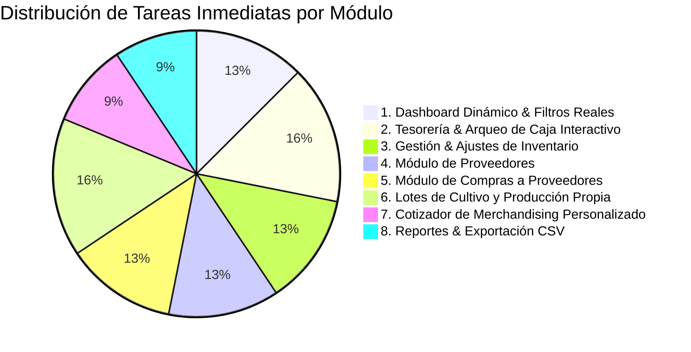

# 📋 Lista de Tareas Pendientes Desarrollables de Inmediato (Checklist "Doable Right Now") — Vivero Colibrí

> **Criterio de Inclusión:** Todas las tareas de este checklist son **100% implementables en este instante**, utilizando únicamente el código fuente existente en React 19, JavaScript y CSS, **sin necesidad de esperar servicios externos, bases de datos remotas ni integraciones de nube**.

> [!NOTE]
> **Actualización tras la conexión con Supabase ([`docs/conexion_base_datos.md`](docs/conexion_base_datos.md)):** productos y ventas ya se persisten en PostgreSQL. Las tareas que tocan esos datos deben implementarse a través de [`src/services/`](src/services/) cuando haya credenciales, conservando el **modo local** (`localStorage`) como respaldo. Las tablas `inventory_movements`, `money_movements`, `accounts`, `suppliers`, `purchases`, `production_batches`, `custom_merch_orders` y `reconciliations` ya existen en [`supabase/schema.sql`](supabase/schema.sql).

---

## 🎯 Resumen de Priorización

---

## 🟢 1. Panel de Inicio (Dashboard): Métricas Dinámicas y Filtros Reales — ✅ Completado
*Los KPIs, alertas de stock, transacciones y chips de días en [`Dashboard.jsx`](src/pages/Dashboard.jsx) ahora calculan sus valores en tiempo real desde Supabase (`sales`, `products`, `accounts`, `money_movements`, `production_batches`).*

- [x] **1.1. Conectar los Chips de Filtro Temporal ([RF-148](docs/requisitos.md#L366))**
  - **Archivos:** [`src/pages/Dashboard.jsx`](src/pages/Dashboard.jsx), [`src/utils/calculations.js`](src/utils/calculations.js)
  - **Acción:** Filtrar `sales` y `transactions` por rango de fechas según el chip seleccionado (*Hoy*, *Ayer*, *Últimos 7 días*, *Este Mes*).
  - **Verificación:** ✅ Al hacer clic en *Hoy*, *Ayer*, *Últimos 7 días* o *Este Mes*, las transacciones mostradas y los totales numéricos cambian en consecuencia.
- [x] **1.2. Calcular Unidades Vendidas Reales ([RF-116](docs/requisitos.md#L298), [RF-140](docs/requisitos.md#L350))**
  - **Archivos:** [`src/pages/Dashboard.jsx`](src/pages/Dashboard.jsx)
  - **Acción:** Reemplazar las constantes `soldUnitsPlants = 116` y `soldUnitsMerch = 26` por una función agregadora que recorra `sale.items` sumando las cantidades según la categoría del producto (`vivero` vs `merchandising`).
- [x] **1.3. Calcular Ganancia y Margen Real del Período ([RF-108](docs/requisitos.md#L280), [RF-142](docs/requisitos.md#L354))**
  - **Archivos:** [`src/pages/Dashboard.jsx`](src/pages/Dashboard.jsx)
  - **Acción:** Calcular ingresos (`SUM(item.subtotal)`), costo de mercancía vendida (`SUM(item.quantity * item.unitCost)`) + egresos y ganancia real (`ingresos - costos`) para el período filtrado.
- [x] **1.4. Alertas de Stock Dinámicas ([RF-32](docs/requisitos.md#L79), [RF-146](docs/requisitos.md#L362))**
  - **Archivos:** [`src/context/AppDataContext.jsx`](src/context/AppDataContext.jsx), [`src/pages/Dashboard.jsx`](src/pages/Dashboard.jsx)
  - **Acción:** Generar las alertas de la tarjeta "Alertas del Sistema" evaluando dinámicamente el array actual de `products` con `getStockStatus(p.stock, p.minStock)` y los lotes de `production_batches`. De esta forma, si se crea o vende un producto quedando con stock bajo, aparece inmediatamente en la lista.

---

## 🟡 2. Tesorería y Arqueo de Caja Interactivo (Conciliación)
*Actualmente en [`Statistics.jsx`](src/pages/Statistics.jsx) el arqueo muestra "$0.00 (Cuadrado)" de forma fija y no permite registrar el conteo real ni justificaciones.*

- [ ] **2.1. Modal de Arqueo Físico de Caja ([RF-102](docs/requisitos.md#L264))**
  - **Archivos:** [`src/pages/Statistics.jsx`](src/pages/Statistics.jsx), [`src/pages/Statistics.css`](src/pages/Statistics.css)
  - **Acción:** Añadir botón "Realizar Arqueo de Caja" que despliegue un modal con el saldo esperado del sistema (calculado como saldo inicial + ventas en efectivo - compras en efectivo) y un campo numérico para ingresar el dinero físico contado.
- [ ] **2.2. Cálculo Automático de Descuadre ([RF-103](docs/requisitos.md#L266))**
  - **Archivos:** [`src/pages/Statistics.jsx`](src/pages/Statistics.jsx)
  - **Acción:** Calcular en tiempo real la diferencia (`dinero_contado - saldo_esperado`). Si es `0`, mostrar indicador verde "Cuadrado"; si es negativo, mostrar "Faltante en Caja" en rojo; si es positivo, "Sobrante" en amarillo.
- [ ] **2.3. Justificación Obligatoria de Descuadres ([RF-104](docs/requisitos.md#L268))**
  - **Archivos:** [`src/pages/Statistics.jsx`](src/pages/Statistics.jsx)
  - **Acción:** Si `diferencia !== 0`, hacer obligatorio un campo de texto `justificacion` antes de permitir guardar el arqueo (ejemplo: "Gasto de transporte no registrado", "Cambio mal entregado").
- [ ] **2.4. Historial de Conciliaciones en Estado ([RF-132](docs/requisitos.md#L332))**
  - **Archivos:** [`src/context/AppDataContext.jsx`](src/context/AppDataContext.jsx)
  - **Acción:** Añadir array `reconciliations: []` en el contexto y función `addReconciliation()`. Guardar la fecha, hora, saldo esperado, saldo real, diferencia y justificación.
- [x] **2.5. Balance y Resumen Financiero Diario ([RF-115 a RF-122](docs/requisitos.md#L295-L310))**
  - **Archivos:** [`src/services/financeService.js`](src/services/financeService.js), [`src/pages/Dashboard.jsx`](src/pages/Dashboard.jsx), [`src/pages/Statistics.jsx`](src/pages/Statistics.jsx)
  - **Acción:** Mostrar desglose de saldo disponible agrupado por medio: **Efectivo en Caja Menor**, **Bancolombia** y **Nequi**, actualizados según las ventas registradas en `accounts`.

---

## 🟢 3. Gestión & Control de Inventario
*En [`Inventory.jsx`](src/pages/Inventory.jsx), el stock está bloqueado en el modal y faltan ajustes manuales y activación de productos.*

- [ ] **3.1. Modal de Ajuste Manual de Inventario ([RF-26](docs/requisitos.md#L67), [RF-27](docs/requisitos.md#L69))**
  - **Archivos:** [`src/pages/Inventory.jsx`](src/pages/Inventory.jsx), [`src/context/AppDataContext.jsx`](src/context/AppDataContext.jsx)
  - **Acción:** Crear botón "Ajuste de Stock" por fila que permita registrar una entrada o salida manual con selector de motivo obligatorio (*Planta marchita/dañada*, *Donación recibida*, *Conteo físico*, *Autoconsumo vivero*).
- [ ] **3.2. Historial de Movimientos de Inventario (Kardex en memoria) ([RF-28 a RF-30](docs/requisitos.md#L71-L75))**
  - **Archivos:** [`src/context/AppDataContext.jsx`](src/context/AppDataContext.jsx), [`src/pages/Inventory.jsx`](src/pages/Inventory.jsx)
  - **Acción:** Añadir colección `inventoryMovements` que guarde cada cambio de stock (sea por venta, ajuste manual o compra), mostrando un modal de "Ver Kardex" por producto.
  - **Avance:** ✅ En Supabase, la tabla `inventory_movements` ya registra automáticamente el stock inicial (`INICIAL`) y cada venta (`SALIDA_VENTA`). Falta la lectura en un servicio y el modal "Ver Kardex".
- [ ] **3.3. Control de Activar / Desactivar Producto ([RF-08](docs/requisitos.md#L23))**
  - **Archivos:** [`src/pages/Inventory.jsx`](src/pages/Inventory.jsx)
  - **Acción:** El campo `active` ya existe en el modelo, pero el modal de edición solo muestra texto estático. Reemplazarlo por un selector o *switch* interactivo (Activo / Inactivo). Los productos inactivos deben quedar ocultos en Nueva Venta pero permanecer visibles en Inventario con un badge "Inactivo".
- [ ] **3.4. Edición de Campos Faltantes ([RF-02](docs/requisitos.md#L11), [RF-07](docs/requisitos.md#L21))**
  - **Archivos:** [`src/pages/Inventory.jsx`](src/pages/Inventory.jsx)
  - **Acción:** Permitir editar la descripción, unidad y ubicación del producto en el modal de edición (actualmente esos campos no se pueden modificar una vez creados).

---

## 🟣 4. Módulo de Proveedores (Totalmente Faltante)
*En [`seguimiento_requisitos.csv`](docs/seguimiento_requisitos.csv) los requisitos RF-10 a RF-14 están marcados como "No iniciado".*

- [ ] **4.1. Estructura de Datos de Proveedores en Contexto ([RF-10](docs/requisitos.md#L29))**
  - **Archivos:** [`src/context/AppDataContext.jsx`](src/context/AppDataContext.jsx), [`src/data/seedData.js`](src/data/seedData.js)
  - **Acción:** Añadir array `seedSuppliers` con proveedores iniciales (ejemplo: *Distribuidora Macetas del Valle*, *Sustratos y Abonos Orgánicos S.A.S.*) y funciones `addSupplier`, `updateSupplier` en `AppDataContext`.
- [ ] **4.2. Vista de Gestión de Proveedores ([RF-11](docs/requisitos.md#L31), [RF-12](docs/requisitos.md#L33))**
  - **Archivos:** Crear `src/pages/Suppliers.jsx` y `src/pages/Suppliers.css`.
  - **Acción:** Tabla con buscador por nombre, contacto, teléfono, correo y botón "Registrar Proveedor".
- [ ] **4.3. Navegación en Navbar y Rutas**
  - **Archivos:** [`src/components/layout/Navbar.jsx`](src/components/layout/Navbar.jsx), [`src/App.jsx`](src/App.jsx)
  - **Acción:** Añadir la ruta `/proveedores` y el enlace en el menú de navegación principal.
- [ ] **4.4. Asociación de Proveedor a Productos Adquiridos ([RF-13](docs/requisitos.md#L35))**
  - **Archivos:** [`src/pages/NewProduct.jsx`](src/pages/NewProduct.jsx)
  - **Acción:** Al seleccionar origen "Adquirido", mostrar un desplegable con los proveedores registrados para vincularlo.

---

## 🔵 5. Módulo de Compras a Proveedores
*El botón "Registrar Compra" existe en Inventario y Dashboard pero no ejecuta ninguna acción ([RF-15 a RF-22](docs/requisitos.md#L41-L58)).*

- [ ] **5.1. Vista de Registro de Compra (`/compras/nueva`) ([RF-15 a RF-19](docs/requisitos.md#L43-L51))**
  - **Archivos:** Crear `src/pages/NewPurchase.jsx` y `src/pages/NewPurchase.css`.
  - **Acción:** Formulario para registrar proveedor, número de factura, fecha, selector de productos, cantidades y costo unitario de compra. Cálculo automático del costo total.
- [ ] **5.2. Actualización Automática de Stock por Compra ([RF-20](docs/requisitos.md#L53))**
  - **Archivos:** [`src/context/AppDataContext.jsx`](src/context/AppDataContext.jsx)
  - **Acción:** Función `addPurchase()` que incremente el stock de los productos comprados y descuente el dinero de la cuenta de pago seleccionada.
- [ ] **5.3. Recálculo de Costo Promedio Ponderado ([RF-33](docs/requisitos.md#L81))**
  - **Archivos:** [`src/utils/calculations.js`](src/utils/calculations.js)
  - **Acción:** Implementar fórmula: `((StockActual * CostoActual) + (CantComprada * CostoCompra)) / (StockTotal)`.
- [ ] **5.4. Historial de Compras ([RF-21](docs/requisitos.md#L55), [RF-22](docs/requisitos.md#L57))**
  - **Archivos:** Crear `src/pages/Purchases.jsx` con tabla de facturas de compra y filtro por proveedor y período.

---

## 🌱 6. Lotes de Cultivo y Producción Propia de Plantas
*Actualmente solo existe una alerta decorativa de ejemplo en el Dashboard ([RF-36 a RF-50](docs/requisitos.md#L87-L128)).*

- [ ] **6.1. Modelo y Estado de Lotes de Producción ([RF-36 a RF-40](docs/requisitos.md#L93-L102))**
  - **Archivos:** [`src/context/AppDataContext.jsx`](src/context/AppDataContext.jsx), [`src/data/seedData.js`](src/data/seedData.js)
  - **Acción:** Añadir array `productionBatches` con campos: `id`, `species`, `quantity`, `startDate`, `estimatedReadyDate`, `status` (*En producción*, *En crecimiento*, *Disponible para venta*), `accumulatedCost`, `notes`.
- [ ] **6.2. Vista o Modal de Monitoreo de Cultivos ([RF-44](docs/requisitos.md#L109), [RF-49](docs/requisitos.md#L123))**
  - **Archivos:** Crear `src/pages/Production.jsx` con tarjetas o tabla de los lotes en curso y sus etapas biológicas.
- [ ] **6.3. Registro de Insumos y Costos Acumulados ([RF-41](docs/requisitos.md#L103), [RF-42](docs/requisitos.md#L105), [RF-48](docs/requisitos.md#L121))**
  - **Acción:** Botón "Agregar Insumo" en el lote (ej. Tierra abonada, Macetas, Fertilizante orgánico) que incremente el costo acumulado del lote.
- [ ] **6.4. Traspaso a Inventario de Venta ([RF-45](docs/requisitos.md#L115), [RF-46](docs/requisitos.md#L117), [RF-47](docs/requisitos.md#L119))**
  - **Acción:** Botón "Declarar Disponible para Venta": calcula el costo unitario (`costo_acumulado / cantidad_final`) y suma las plantas al catálogo de inventario activo.
- [ ] **6.5. Alerta de Producción Demorada ([RF-50](docs/requisitos.md#L125))**
  - **Acción:** Evaluar si `fecha_actual > fecha_estimada` para mostrar badge de advertencia "Tiempo Excedido por Clima/Factores".

---

## 🎨 7. Cotizador de Merchandising Personalizado
*Actualmente se puede registrar un producto tipo "merchandising", pero sin costeo variable de personalización ([RF-51 a RF-60](docs/requisitos.md#L130-L163)).*

- [ ] **7.1. Calculadora de Personalización en Nueva Venta o Modal Especial ([RF-53 a RF-57](docs/requisitos.md#L137-L146))**
  - **Archivos:** [`src/pages/NewSale.jsx`](src/pages/NewSale.jsx)
  - **Acción:** Al seleccionar una prenda o artículo personalizable:
    - Campo de costo base de la prenda (ej. $25.000).
    - Campo de costo de personalización/estampado (ej. $10.000).
    - Costo total calculado ($35.000).
    - Input de precio de venta final pactado con el cliente (ej. $50.000).
    - Cálculo visual de la ganancia proyectada ($15.000) y margen (30%).
- [ ] **7.2. Registro de Especificaciones en el Comprobante ([RF-58](docs/requisitos.md#L147), [RF-60](docs/requisitos.md#L151))**
  - **Acción:** Guardar en el ticket los detalles específicos (ej. "Talla M, Logo Comunitario en pecho").

---

## 📊 8. Búsquedas, Reportes y Validaciones Inmediatas

- [ ] **8.1. Búsqueda de Ventas por Producto y Filtro por Fecha ([RF-72](docs/requisitos.md#L188), [RF-73](docs/requisitos.md#L190), [RF-75](docs/requisitos.md#L194))**
  - **Archivos:** [`src/pages/Sales.jsx`](src/pages/Sales.jsx)
  - **Acción:** Ampliar el buscador actual para que coincida también si el texto digitado coincide con el nombre de algún producto contenido dentro de la venta, y añadir selectores de fecha `Desde` y `Hasta`.
- [x] **8.2. Exportar Reportes a CSV en Estadísticas ([RF-138](docs/requisitos.md#L344))**
  - **Archivos:** [`src/pages/Statistics.jsx`](src/pages/Statistics.jsx), [`src/utils/exportCSV.js`](src/utils/exportCSV.js)
  - **Acción:** Conectar el botón "Exportar Reporte" con `exportToCSV` para descargar un archivo con el balance consolidado del período seleccionado.
- [ ] **8.3. Validaciones de Negocio Estrictas ([RNF-16](docs/requisitos.md#L409), [RNF-17](docs/requisitos.md#L412))**
  - **Archivos:** [`src/pages/NewProduct.jsx`](src/pages/NewProduct.jsx), [`src/pages/NewSale.jsx`](src/pages/NewSale.jsx)
  - **Acción:** Bloquear precios o costos negativos o iguales a cero, validar formato numérico de teléfono y número de documento del cliente.
  - **Avance:** ✅ La BD ya rechaza cantidades, precios y descuentos inválidos en las ventas y recalcula los totales en el servidor. Faltan las validaciones en los formularios.

---

## ⏱️ Estimación de Esfuerzo para el Equipo

| Grupo de Tareas | Complejidad | Tiempo Estimado | Impacto en la Entrega al Cliente |
| :--- | :---: | :---: | :--- |
| **1. Dashboard Dinámico & Filtros** | Baja | 3 - 4 horas | **Inmediato:** Quita las cifras estáticas que delatan un prototipo. |
| **2. Arqueo & Conciliación Real** | Media | 4 - 5 horas | **Crítico:** Resuelve la necesidad contable principal del cliente. |
| **3. Ajustes de Inventario & Kardex** | Media | 4 - 5 horas | **Alto:** Permite controlar mermas y pérdidas de plantas. |
| **4. Módulo de Proveedores** | Baja | 3 horas | **Alto:** Completa la gestión de compras. |
| **5. Módulo de Compras** | Media | 5 horas | **Crítico:** Habilita el cálculo de costo promedio real. |
| **6. Lotes de Cultivo Vivero** | Media | 6 horas | **Diferenciador:** Responde a la realidad biológica del vivero. |
| **7. Cotizador de Merchandising** | Baja | 3 horas | **Medio:** Agiliza cotizaciones personalizadas. |
| **8. Búsquedas y Exportaciones CSV** | Baja | 2 horas | **Alto:** Facilita la auditoría de ventas. |
