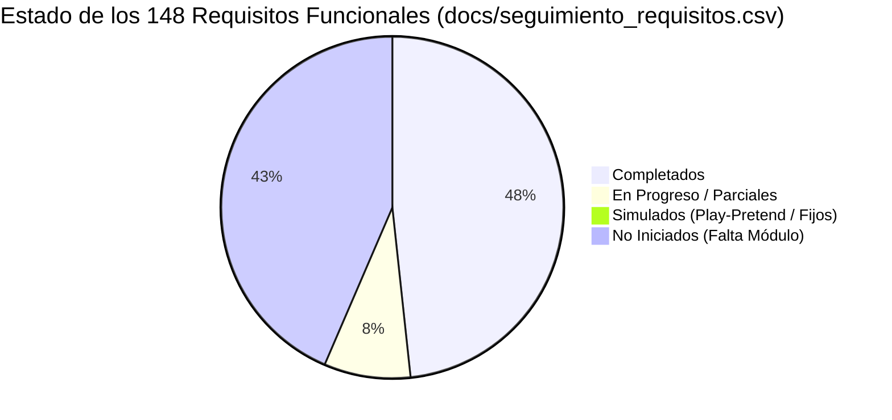
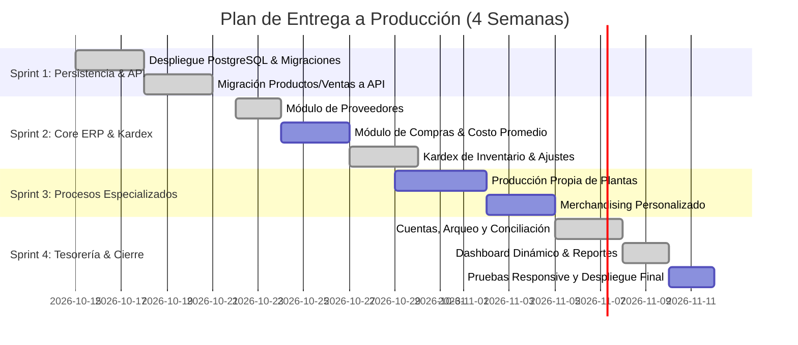

# 🗺️ Hoja de Ruta de Desarrollo (Roadmap a 4 Semanas) — Vivero Colibrí

Este documento traza el plan de ejecución táctico para que el equipo de desarrollo transforme el prototipo actual en una solución **100% lista para el cliente (Client-Ready)** en el plazo perentorio de **un mes**.

El plan aborda sistemáticamente las simulaciones ("play-pretends") identificadas en el código fuente y en la matriz de seguimiento [`docs/seguimiento_requisitos.csv`](docs/seguimiento_requisitos.csv).

---

## 🔍 1. Diagnóstico del Estado Actual vs. Brechas Críticas

### Principales Simulaciones a Eliminar:
1. ~~**Persistencia en Navegador:** Datos almacenados en `localStorage` con límite de ~5 MB; si se borran cookies o se abre desde otro dispositivo, los datos no existen (RNF-15, RNF-37).~~ ✅ Productos, ventas, cuentas, movimientos de dinero, movimientos de inventario (Kardex), conciliaciones y lotes se leen de Supabase (ver [`docs/conexion_base_datos.md`](docs/conexion_base_datos.md)). `localStorage` queda solo como modo local sin credenciales.
2. ~~**Dashboard con Datos Estáticos:** Los KPIs diarios ("+18% vs día anterior", $1.850.000 de ganancia, 116 unidades vendidas) están codificados fijamente en [`src/pages/Dashboard.jsx`](src/pages/Dashboard.jsx).~~ ✅ KPIs, alertas de stock, lotes activos y transacciones del Panel ahora se calculan en tiempo real desde la base de datos.
3. ~~**Conciliación Falsa ($0 Descuadre):** La sección de arqueo en [`src/pages/Statistics.jsx`](src/pages/Statistics.jsx) muestra "$0.00 Diferencia (Cuadrado)" sin permitir ingresar el conteo físico de dinero real ni registrar justificaciones (RF-102 a RF-104).~~ ✅ Modal interactivo de Arqueo y Conciliación (con cálculo de faltante/sobrante, justificación obligatoria, ajuste automático de cuenta, traslado entre cuentas e historial de conciliaciones) implementado y conectado a Supabase.
4. ~~**Filtros Temporales Inactivos:** Los selectores *Hoy / Ayer / Últimos 7 días / Este Mes* son decorativos y no filtran registros reales por fecha.~~ ✅ Los filtros de período en el Panel, en Estadísticas y en el Kardex de Inventario filtran registros reales por fecha.
5. **Módulos Faltantes:** Proveedores, Compras y Producción Propia de Plantas aún no tienen pantallas dedicadas en el frontend (sus tablas ya existen en Supabase).

---

## 📅 2. Cronograma de Sprints (Plan de 4 Semanas)

---

### 🚀 Sprint 1 (Semana 1): Capa de Datos Real y Backend Base
> **Objetivo:** Erradicar `localStorage` y conectar el frontend existente a una base de datos relacional.

- [x] **Infraestructura de Datos:**
  - ~~Crear proyecto PostgreSQL en Supabase / Railway.~~ ✅ Proyecto Supabase creado y configurado.
  - ~~Ejecutar migraciones del esquema relacional definido en [`TECHSTACK.md`](TECHSTACK.md).~~ ✅ Esquema ejecutado vía `supabase/schema.sql` + `supabase/migration_01_conexion_frontend.sql`.
  - ~~Ejecutar script de seed inicial con los datos de [`src/data/seedData.js`](src/data/seedData.js).~~ ✅ Datos semilla cargados vía `supabase/seed.sql`.
- [x] **Migración de Módulos Existentes:**
  - ~~Instalar `@tanstack/react-query` en el frontend.~~ ✅ Instalado `@tanstack/react-query` v5 y `@supabase/supabase-js`. `QueryClientProvider` configurado en `src/main.jsx` con caché de 5 min, gc de 30 min y retry de 1 intento.
  - ~~Crear cliente Supabase y capa de servicios.~~ ✅ Creados `src/services/supabaseClient.js`, `src/services/productsService.js`, `src/services/salesService.js`, `src/services/financeService.js`, `src/services/inventoryService.js` y `src/hooks/useProducts.js`.
  - ~~Conectar [`src/pages/Inventory.jsx`](src/pages/Inventory.jsx) al endpoint `GET /api/products` y `PATCH /api/products/:id`.~~ ✅ Inventario y Registro de Producto leen/escriben la tabla `products` vía `productsService.js` (el stock inicial queda en el Kardex por trigger).
  - ~~Conectar [`src/pages/NewSale.jsx`](src/pages/NewSale.jsx) al endpoint transaccional `POST /api/sales`.~~ ✅ Nueva Venta usa la función RPC `process_sale_transaction` (venta atómica: stock, detalle, Kardex `SALIDA_VENTA` y entrada de dinero en la cuenta del medio de pago).
  - ~~Conectar [`src/pages/Sales.jsx`](src/pages/Sales.jsx) al historial en servidor.~~ ✅ El historial se lee de `sales` + `sale_items`. ⏳ *Pendiente:* paginación y búsqueda en servidor (hoy se cargan todas las ventas y se filtra en el navegador).
  - ✅ Aviso de carga / error de conexión (`DataStatusBanner.jsx`) y **modo local** automático cuando no hay credenciales de Supabase.

---

### 📦 Sprint 2 (Semana 2): Proveedores, Compras y Kardex de Inventario
> **Objetivo:** Cerrar el ciclo de abastecimiento de productos adquiridos y habilitar la trazabilidad de inventario.

- [x] **Módulo de Proveedores (RF-10 a RF-14):**
  - ~~Crear vista `/proveedores` con listado, buscador y formulario de alta/edición.~~ ✅ Implementada en [`src/pages/Suppliers.jsx`](src/pages/Suppliers.jsx) y conectada a Supabase vía [`src/services/suppliersService.js`](src/services/suppliersService.js).
  - ~~Asociar productos del catálogo con sus respectivos proveedores habituales.~~ ✅ Vinculación disponible desde `/proveedores`, `/inventario/nuevo` y el modal de edición en `/inventario`, además de consulta del historial de compras por proveedor (`RF-14`).
- [ ] **Módulo de Compras (RF-15 a RF-22):**
  - Implementar vista `/compras/nueva` para registrar facturas de proveedores.
  - Actualización automática de existencias al ingresar una compra.
  - Recálculo automático del **costo promedio ponderado** (RF-33).
- [x] **Kardex y Movimientos de Inventario (RF-24 a RF-30):**
  - ~~La tabla `inventory_movements` registra automáticamente el stock inicial (`INICIAL`) y las salidas por venta (`SALIDA_VENTA`).~~ ✅ Conectada al frontend vía [`src/services/inventoryService.js`](src/services/inventoryService.js).
  - ~~Pantalla o pestaña de *Historial de Movimientos* por producto.~~ ✅ Modal de Kardex en [`src/pages/Inventory.jsx`](src/pages/Inventory.jsx) con filtros por producto (`RF-29`), período (`RF-30`), sentido (entradas/salidas) y exportación CSV.
  - ~~Modal para **Ajustes de Inventario** con campo obligatorio de justificación/motivo (merma, rotura, donación social).~~ ✅ Modal de Ajuste Manual (`AJUSTE_MANUAL_ENTRADA` y `AJUSTE_MANUAL_SALIDA`) implementado en [`src/pages/Inventory.jsx`](src/pages/Inventory.jsx).

---

### 🌿 Sprint 3 (Semana 3): Producción Propia de Plantas & Merchandising
> **Objetivo:** Incorporar las dinámicas especializadas de cultivo biológico y personalización comunitaria.

- [ ] **Producción Biológica de Vivero (RF-36 a RF-50):**
  - Vista `/produccion` para monitorear lotes activos.
  - Formulario de alta de lote: especie, cantidad inicial, fecha de inicio y fecha estimada de maduración.
  - Registro de insumos aplicados (sustrato, fertilizantes, macetas) y acumulación de costos.
  - Transición de estados: *En producción* → *En crecimiento* → *Disponible para venta*.
  - Acción de cierre de lote: cálculo del costo unitario real y traspaso automático al catálogo de venta.
  - Alerta de lotes con tiempo excedido o condiciones climáticas adversas (RF-43, RF-50).
- [ ] **Merchandising Personalizado (RF-51 a RF-60):**
  - Vista/Cotizador de personalizaciones comunitarias:
    - Selección de producto base (ej. camiseta, maceta artesanal).
    - Adición de costos de materiales extras y mano de obra.
    - Fijación de precio final y cálculo automático del margen de ganancia proyectado.
  - Registro del pedido en el historial de productos personalizados vendidos.

---

### 💰 Sprint 4 (Semana 4): Tesorería, Conciliación Real, Dashboard y Despliegue
> **Objetivo:** Proveer transparencia financiera total, reportes auditables y dejar el sistema operando en producción.

- [x] **Control de Fondos y Arqueo (RF-93 a RF-104):**
  - ~~Módulo de cuentas: Efectivo (caja menor), Nequi, Bancolombia.~~ ✅ Conectado a la tabla `accounts` con opción de traslado de fondos entre cuentas (`RF-101`).
  - ~~Pantalla interactiva de **Arqueo y Conciliación**:~~ ✅ Implementada en [`src/pages/Statistics.jsx`](src/pages/Statistics.jsx) y [`src/services/financeService.js`](src/services/financeService.js):
    - Muestra el saldo teórico esperado calculado por el sistema.
    - Campo para ingresar el dinero físico contado o saldo verificado en extracto.
    - Cálculo visual de diferencias (Cuadrado / Faltante / Sobrante).
    - Campo obligatorio de justificación del descuadre para auditoría y tabla de historial de conciliaciones (`RF-132`).
- [x] **Cierre Diario y Métricas Reales (RF-105 a RF-122):**
  - ~~Conectar el Dashboard para que los KPIs reflejen ventas, ingresos y egresos del período en tiempo real.~~ ✅ Conectado en [`src/pages/Dashboard.jsx`](src/pages/Dashboard.jsx).
  - ~~Hacer funcionales los botones de filtro temporal (*Hoy, Ayer, 7 días, Este Mes*).~~ ✅ Conectados en Dashboard y Estadísticas.
  - ~~Gráfico dinámico de ingresos vs. egresos con datos reales de la base de datos.~~ ✅ Conectado en [`src/pages/Statistics.jsx`](src/pages/Statistics.jsx).
- [ ] **Reportes y Exportación (RF-123 a RF-138):**
  - Exportación en CSV de reportes de inventario, compras, conciliaciones y ventas.
- [ ] **Validación No Funcional & Entrega:**
  - Pruebas de diseño responsive en teléfonos inteligentes y tabletas (RNF-07 a RNF-10).
  - Verificación de copias de seguridad automáticas (RNF-25).
  - ~~Despliegue en producción (Frontend en Cloudflare Pages, Backend en Supabase).~~ ✅ Frontend desplegado en Cloudflare Pages y base de datos activa en Supabase.
  - Capacitación del cliente y entrega formal de los accesos a los servicios (Supabase, Cloudflare Pages).

---

## ⚠️ 3. Matriz de Riesgos y Planes de Contingencia

| Riesgo Identificado | Impacto | Probabilidad | Estrategia de Mitigación |
| :--- | :---: | :---: | :--- |
| **Poco tiempo del equipo para desarrollar backend desde cero** | Alto | Alta | ✅ **Mitigado: se adoptó Supabase BaaS**. PostgreSQL y API REST operativos sin escribir un backend propio; la lógica transaccional vive en funciones SQL (RPC). |
| **Resistencia o errores del usuario al registrar arqueos de caja** | Alto | Media | Interfaz simple paso a paso con advertencias claras de color ante faltantes y recordatorio amable de registrar la justificación. |
| **Pérdida de conectividad a internet en el vivero físico** | Medio | Media | La app permanece abierta en el navegador; en caso de caída temporal, el aviso de conexión (`DataStatusBanner`) y el POS muestran una alerta clara para reintentar al reconectar. |

---

*Para dudas de implementación técnica o especificaciones de esquemas, referirse a [`TECHSTACK.md`](TECHSTACK.md) y [`ARCHITECTURE.md`](ARCHITECTURE.md).*
