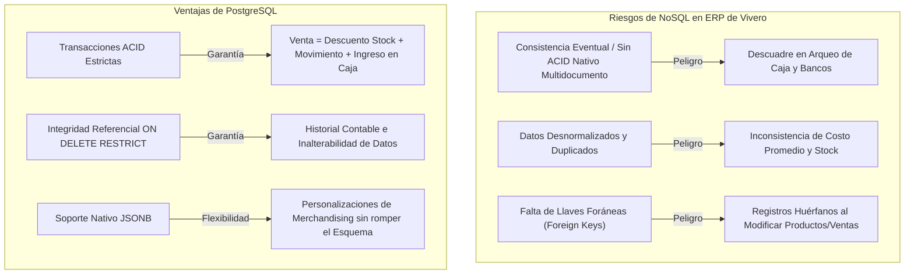

# 🏛️ Definición del Stack Tecnológico Definitivo — Vivero Colibrí

Este documento establece la propuesta técnica y arquitectónica definitiva para transicionar el sistema **Vivero Colibrí** desde su actual prototipo interactivo (con datos simulados en memoria y `localStorage`) hacia una plataforma en producción **lista para el cliente en el plazo de 1 mes**.

---

## 📌 1. Resumen Ejecutivo y Matriz de Decisión

| Capa / Componente | Tecnología Seleccionada | Justificación Técnica Clave |
| :--- | :--- | :--- |
| **Frontend** | **React 19 + Vite 8** *(Existente)* | Ya estructurado en el repositorio; tiempo de compilación ultrarrápido (1.3 s), renderizado reactivo eficiente y componentes modulares listos. |
| **Cliente de Datos / Cache** | **TanStack Query (React Query v5)** | Reemplaza la manipulación manual de `localStorage`, gestionando estado del servidor, reintentos, cache en memoria y estados de carga (`isLoading`, `isError`). |
| **Base de Datos** | **PostgreSQL 16+** | **Relacional con ACID estricto**. Imprescindible para conciliaciones contables, arqueos de caja, trazabilidad de lotes de cultivo y kardex de inventario. Columnas `JSONB` para atributos dinámicos de merchandising. |
| **Backend & API** | **Node.js (TypeScript) + Express / Fastify con Prisma ORM** *(o Supabase BaaS)* | Unifica el lenguaje con el frontend (JavaScript/TypeScript), eliminando la fricción de cambio de contexto en el equipo. Generación de tipos automática y migraciones declarativas seguras. |
| **Autenticación & Seguridad** | **JWT con Cookies HttpOnly / Supabase Auth** | Control de acceso basado en roles (RBAC: *Administrador*, *Ventas*, *Producción*), mitigación de XSS/CSRF y protección de datos financieros sensibles. |
| **Infraestructura & Despliegue** | **Vercel (Frontend) + Supabase / Railway (Backend + DB)** | Niveles de uso gratuitos y de bajo costo ideales para proyectos de labor social; copias de seguridad automatizadas diarias (RNF-25), alta disponibilidad (RNF-14) y cero mantenimiento de servidores. |

---

## ⚖️ 2. Análisis Crítico: ¿Por qué NoSQL es un Riesgo Crítico y Relacional (PostgreSQL) es la Elección Correcta?

Una de las principales incertidumbres del equipo ha sido: *¿Deberíamos usar una base de datos NoSQL (MongoDB, Firestore, DynamoDB) o una base de datos Relacional (SQL)?*

A continuación se fundamenta por qué **NoSQL resulta inadecuado y peligroso para este proyecto**, mientras que **PostgreSQL garantiza el éxito operativo**:



### 2.1. Las operaciones del negocio son intrínsecamente transaccionales (ACID)
En el flujo comercial de Vivero Colibrí, **una sola venta** no es un registro aislado:
1. Registra el encabezado y detalle de la venta (`sales`, `sale_items`).
2. Descuenta las existencias del catálogo de inventario (`products.stock`).
3. Registra el movimiento de salida en el kardex (`inventory_movements`).
4. Genera un registro de ingreso económico (`income`).
5. Incrementa el saldo disponible en la cuenta correspondiente (*Efectivo*, *Nequi* o *Bancolombia*).

Si el sistema falla en el paso 4 o 5 (por ejemplo, desconexión de red), una base NoSQL tradicional deja los documentos desincronizados: el inventario disminuye pero el dinero no aparece en caja. **PostgreSQL ejecuta todas estas operaciones dentro de una sola transacción (`BEGIN ... COMMIT`)**, asegurando que si una parte falla, todo se revierte (`ROLLBACK`), protegiendo el dinero y el inventario (RNF-18, RNF-20, RNF-21).

### 2.2. Conciliación de caja y arqueo financiero (RF-93 a RF-104)
El cliente no solo quiere saber cuánto vendió; necesita comprobar que el dinero físico en la gaveta y en las cuentas bancarias coincide exactamente con el historial de operaciones.
- En SQL, el saldo teórico de una cuenta es una suma determinista: `SELECT SUM(amount) FROM money_movements WHERE account_id = $1`.
- En NoSQL, la consistencia eventual o la desnormalización de saldos en documentos de clientes/ventas genera descuadres fantasmas difíciles de rastrear y depurar.

### 2.3. Costos variables y etapas biológicas de cultivo (RF-36 a RF-50)
Las plantas no aparecen mágicamente en inventario:
- Un lote de siembra pasa por *En producción* → *En crecimiento* → *Disponible para venta*.
- Durante 2 a 6 meses acumula costos variables de insumos (sustrato, abonos, pesticidas, macetas, mano de obra).
- Al momento de declararse disponible, se calcula el **costo unitario real de producción** sumando los insumos registrados y dividiendo por las unidades vivas obtenidas.
Este modelo encaja de forma natural en una estructura relacional con llaves foráneas (`batch_id` → `production_inputs` → `products`).

### 2.4. Flexibilidad sin sacrificar orden: El poder de `JSONB` en PostgreSQL
La única razón legítima para considerar NoSQL solía ser la variabilidad de atributos (ejemplo: personalizaciones de merchandising: color, talla, técnica de estampado, ubicación del logo).
**PostgreSQL resuelve esto nativamente mediante columnas `JSONB`**, permitiendo consultar, indexar y almacenar datos semiestructurados dentro de tablas relacionales estrictas. Se obtiene lo mejor de ambos mundos:
- Control financiero y relacional estricto en tablas SQL.
- Especificaciones de personalización dinámicas en campos JSONB.

---

## 💻 3. Definición Detallada del Stack Tecnológico

```mermaid
flowchart LR
    subgraph Cliente ["Capa de Presentación (Frontend)"]
        UI["React 19 + CSS Modules"]
        Router["React Router v7"]
        Query["TanStack Query v5"]
    end

    subgraph Servidor ["Capa de Lógica de Negocio (Backend)"]
        API["Node.js / Express o Fastify (TypeScript)"]
        Validation["Validación Zod"]
        ORM["Prisma ORM"]
        Auth["JWT / Middleware RBAC"]
    end

    subgraph Persistencia ["Capa de Datos (Almacenamiento)"]
        PG[("PostgreSQL 16")]
        Backup[("Respaldos Diarios Automatizados")]
    end

    UI --> Router
    Router --> Query
    Query -->|"HTTPS / REST (JSON)"| API
    API --> Validation
    Validation --> Auth
    Auth --> ORM
    ORM -->|"SQL / Pool Conexiones"| PG
    PG -.->|"Backup Snapshots"| Backup
```



### 3.1. Frontend: React 19 + Vite 8
- **Estado actual:** El código existente en `src/` ya cuenta con vistas responsive bien maquetadas (`Dashboard.jsx`, `Inventory.jsx`, `NewProduct.jsx`, `NewSale.jsx`, `Sales.jsx`, `Statistics.jsx`).
- **Cambios inmediatos para producción:**
  1. Reemplazar la persistencia local de `AppDataContext.jsx` por consumo de API mediante **TanStack Query**.
  2. Implementar interceptores HTTP para enviar tokens de autenticación y manejar errores globales de red con los Toasts ya creados.
  3. Validar filtros reales en servidor para rangos de fechas (Día, Semana, Mes, Rango personalizado).

### 3.2. Backend: Node.js (TypeScript) + Express / Fastify + Prisma ORM
Considerando que el equipo ya domina JavaScript/React y que el plazo de entrega es de **4 semanas**:
- **¿Por qué Node.js sobre Python/Django?**
  Aunque el documento inicial mencionaba Python/Django como alternativa, implementar Node.js con TypeScript permite al equipo compartir modelos de datos, validaciones y tipos entre cliente y servidor sin la curva de aprendizaje ni el doble entorno de ejecución de Python.
- **¿Por qué Prisma ORM?**
  Prisma ofrece un esquema declarativo legible (`schema.prisma`), migraciones automáticas seguras y un cliente con tipado estricto que previene errores de sintaxis SQL en tiempo de compilación.

#### 💡 Alternativa de Máxima Rapidez: Supabase (PostgreSQL Gestionado + Auth)
Si el tiempo del equipo es extremadamente limitado durante las próximas dos semanas, **Supabase** es la vía más rápida y recomendada:
- Provee una base de datos PostgreSQL real y completa.
- Sistema de Autenticación listo para usar (usuarios, roles, contraseñas encriptadas con bcrypt).
- API REST generada instantáneamente a partir de las tablas de PostgreSQL.
- Copias de seguridad automáticas diarias incluidas en la capa gratuita (cumple RNF-25 inmediatamente).
- La lógica transaccional compleja (ej. cerrar venta y descontar stock) se ejecuta mediante funciones SQL (`RPC`) seguras.

---

## 🗄️ 4. Modelo Entidad-Relación y Esquema de Base de Datos

> [!TIP]
> **Script DDL y Datos Semilla Disponibles:** El script SQL ejecutable completo para PostgreSQL y Supabase se encuentra listo en [`supabase/schema.sql`](supabase/schema.sql), acompañado por los datos iniciales en [`supabase/seed.sql`](supabase/seed.sql). Puedes copiar y pegar directamente su contenido en el **SQL Editor** de Supabase para aprovisionar la base de datos en 1 minuto.

El siguiente diagrama modela la totalidad de los requisitos funcionales del sistema (Productos, Proveedores, Compras, Inventario/Kardex, Producción Biológica, Merchandising, Ventas, Tesorería y Conciliación):

```mermaid
erDiagram
    USERS ||--o{ SALES : "registra"
    USERS ||--o{ PURCHASES : "registra"
    USERS ||--o{ RECONCILIATIONS : "ejecuta"

    CATEGORIES ||--o{ PRODUCTS : "clasifica"
    SUPPLIERS ||--o{ PURCHASES : "provee"
    SUPPLIERS ||--o{ PRODUCTS : "suministra"

    PURCHASES ||--o{ PURCHASE_ITEMS : "contiene"
    PRODUCTS ||--o{ PURCHASE_ITEMS : "adquirido_en"

    PRODUCTS ||--o{ INVENTORY_MOVEMENTS : "registra_kardex"
    
    PRODUCTS ||--o{ PRODUCTION_BATCHES : "produce"
    PRODUCTION_BATCHES ||--o{ PRODUCTION_INPUTS : "consume"
    PRODUCTION_BATCHES ||--o{ PRODUCTION_COSTS : "acumula"

    PRODUCTS ||--o{ CUSTOM_MERCH_ORDERS : "personaliza"
    SALES ||--o{ CUSTOM_MERCH_ORDERS : "factura"

    SALES ||--o{ SALE_ITEMS : "incluye"
    PRODUCTS ||--o{ SALE_ITEMS : "vendido_en"

    ACCOUNTS ||--o{ MONEY_MOVEMENTS : "afecta"
    ACCOUNTS ||--o{ RECONCILIATIONS : "concilia"

    SALES ||--o{ MONEY_MOVEMENTS : "genera_ingreso"
    PURCHASES ||--o{ MONEY_MOVEMENTS : "genera_egreso"

    USERS {
        uuid id PK
        string email UK
        string password_hash
        string full_name
        string role "ADMIN | VENDEDOR | OPERADOR"
        boolean active
        timestamp created_at
    }

    CATEGORIES {
        int id PK
        string name UK
        string description
    }

    SUPPLIERS {
        int id PK
        string name
        string contact_name
        string phone
        string email
        string address
        boolean active
    }

    PRODUCTS {
        uuid id PK
        string sku UK
        string name
        int category_id FK
        string origin "VIVERO | MERCHANDISING | ADQUIRIDO"
        int current_stock
        int min_stock
        decimal base_cost
        decimal base_price
        string location
        string unit
        string description
        boolean active
    }

    INVENTORY_MOVEMENTS {
        uuid id PK
        uuid product_id FK
        string movement_type "ENTRADA_COMPRA | SALIDA_VENTA | ENTRADA_PRODUCCION | AJUSTE"
        int quantity
        int previous_stock
        int resulting_stock
        string reason
        uuid reference_id "ID de venta, compra o lote"
        timestamp created_at
    }

    PURCHASES {
        uuid id PK
        int supplier_id FK
        uuid user_id FK
        date purchase_date
        decimal total_cost
        string invoice_number
        timestamp created_at
    }

    PURCHASE_ITEMS {
        uuid id PK
        uuid purchase_id FK
        uuid product_id FK
        int quantity
        decimal unit_cost
        decimal subtotal
    }

    PRODUCTION_BATCHES {
        uuid id PK
        uuid target_product_id FK
        string plant_species
        int initial_quantity
        int current_quantity
        date start_date
        date estimated_ready_date
        date actual_ready_date
        string status "EN_PRODUCCION | EN_CRECIMIENTO | DISPONIBLE | PERDIDA"
        text environmental_conditions
        decimal accumulated_cost
        timestamp created_at
    }

    PRODUCTION_INPUTS {
        uuid id PK
        uuid batch_id FK
        string input_name "Tierra, Maceta, Fertilizante"
        int quantity
        decimal unit_cost
        decimal total_cost
        date application_date
    }

    CUSTOM_MERCH_ORDERS {
        uuid id PK
        uuid base_product_id FK
        uuid sale_id FK
        string customer_name
        int units
        decimal base_price
        decimal custom_costs
        decimal final_sale_price
        decimal estimated_profit
        jsonb custom_specifications "Talla, Colores, Textos, Ubicación"
        timestamp created_at
    }

    SALES {
        uuid id PK
        string sale_code UK "VTA-001"
        uuid user_id FK
        string customer_name
        string customer_document
        string customer_phone
        decimal subtotal
        decimal discount
        decimal total
        string payment_method "EFECTIVO | NEQUI | BANCOLOMBIA"
        string sale_channel "PRESENCIAL | VIRTUAL"
        timestamp created_at
    }

    SALE_ITEMS {
        uuid id PK
        uuid sale_id FK
        uuid product_id FK
        int quantity
        decimal unit_price
        decimal unit_cost
        decimal subtotal
    }

    ACCOUNTS {
        int id PK
        string name "Efectivo Caja Menor | Bancolombia | Nequi"
        string account_type "EFECTIVO | BANCO"
        decimal current_balance
        boolean active
    }

    MONEY_MOVEMENTS {
        uuid id PK
        int account_id FK
        string movement_type "INGRESO_VENTA | EGRESO_COMPRA | GASTO_OPERATIVO | TRANSFERENCIA"
        decimal amount
        string concept
        date movement_date
        uuid reference_id
        timestamp created_at
    }

    RECONCILIATIONS {
        uuid id PK
        int account_id FK
        uuid user_id FK
        date reconciliation_date
        decimal system_expected_balance
        decimal physical_counted_balance
        decimal difference
        text justification
        string status "CUADRADO | DESCUADRE_JUSTIFICADO"
        timestamp created_at
    }
```



---

## 🔄 5. Estrategia de Migración: De `seedData.js` a Base de Datos Real

Actualmente, [`src/context/AppDataContext.jsx`](src/context/AppDataContext.jsx) orquesta las operaciones en memoria con persistencia en `localStorage`. Para dar el salto a producción sin romper la interfaz existente, se seguirá este procedimiento:

### Fase 1: Creación del Script de Siembra (Seed Script)
Los datos de prueba existentes en [`src/data/seedData.js`](src/data/seedData.js) (productos, clientes, transacciones históricas) han sido estructurados en el archivo ejecutable [`supabase/seed.sql`](supabase/seed.sql) para poblar la base de datos PostgreSQL en el primer despliegue.

### Fase 2: Capa de Servicios de API (`src/services/`)
Se crearán módulos de consumo HTTP con `fetch` o `axios`:
- `services/productsService.js`: `getProducts()`, `createProduct()`, `updateProduct()`.
- `services/salesService.js`: `getSales()`, `createSale()`, `getSaleById()`.
- `services/inventoryService.js`: `getMovements()`, `adjustStock()`.
- `services/financeService.js`: `getBalances()`, `reconcileAccount()`, `getDailySummary()`.

### Fase 3: Transición de `AppDataContext` a React Query
En lugar de mutar un objeto gigante de datos en `localStorage`, cada componente consumirá sus datos mediante hooks especializados:
```javascript
// Ejemplo de migración en Inventory.jsx
export function useProducts(filters) {
  return useQuery({
    queryKey: ['products', filters],
    queryFn: () => productsService.getProducts(filters),
    staleTime: 1000 * 60 * 5, // 5 minutos de cache
  });
}
```

---

## 🛡️ 6. Cumplimiento de Requisitos No Funcionales (RNF)

| Requisito | Descripción | Solución Técnica Implementada |
| :--- | :--- | :--- |
| **RNF-11 a RNF-13** | Rendimiento y Escalabilidad | PostgreSQL indexa campos clave (`sku`, `created_at`, `sale_code`). La paginación en backend evita sobrecargar el navegador. |
| **RNF-14 y RNF-15** | Disponibilidad y Portabilidad | Backend desplegado en nube pública accesible desde cualquier computador, tablet o teléfono con conexión a Internet. |
| **RNF-16 a RNF-21** | Integridad de la Información | Restricciones de llaves foráneas (`FOREIGN KEY`), validaciones `CHECK (stock >= 0)`, y transacciones ACID en checkout. |
| **RNF-22 a RNF-24** | Seguridad y Control Financiero | Contraseñas protegidas con algoritmos de hashing seguros (Argon2 / bcrypt); validación estricta de saldos en servidor. |
| **RNF-25 a RNF-27** | Copias de Seguridad | Backups diarios automáticos y recuperación a un punto en el tiempo (PITR) provistos por el proveedor de PostgreSQL. |
| **RNF-28 y RNF-29** | Compatibilidad y Responsive | Build optimizado con Vite, CSS con diseño elástico y navegación optimizada para pantallas táctiles y de escritorio. |

---

## 🚀 7. Decisión Final para el Equipo

Para estar listos para el cliente en 4 semanas con un equipo con recursos de tiempo acotados:

1. **Base de Datos:** **PostgreSQL** alojado en Supabase o Railway. **Se descarta rotundamente NoSQL** por riesgos contables y operativos.
2. **Backend:** **Node.js (TypeScript) + Express con Prisma ORM** (o API de Supabase con funciones SQL transaccionales).
3. **Frontend:** Mantener la base actual en **React 19 + Vite**, integrando **TanStack Query** para la comunicación con el servidor.

Consulta el plan cronológico detallado en [`ROADMAP.md`](ROADMAP.md) y la arquitectura de flujos en [`ARCHITECTURE.md`](ARCHITECTURE.md).
